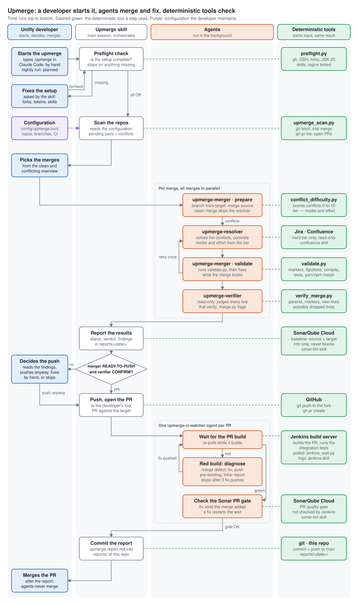

# unifly-upmerge

A Claude Code skill, `upmerge`, merges each Unifly version branch into the next one across the Unifly repos. Which repos and which branches is [configuration](#configuration-repos-and-branches-to-merge), not code. Four sub-agents do the merging, conflict solving, checking and CI follow-up, on top of deterministic tools: git, Gradle and npm, Jenkins, SonarQube Cloud, and Jira for the hardest conflicts. A Unifly developer picks the merges up front and does the final PR merge. Today a Unifly developer starts every run by hand, with `/upmerge` in Claude Code; the goal is a nightly run.

## At a glance



Each lane shows who does a step. Orange boxes are agents running in the background: one pipeline per merge and one CI watcher per PR. White boxes are steps the `upmerge` skill does itself in the main session. The Unifly developer starts the run and steps in only at the blue boxes. Green boxes are the deterministic tools the steps call: the scripts in this repo (preflight, scan, validate, verify), git and gh, Gradle and npm, Jenkins, SonarQube Cloud, and Jira and Confluence on the hard tier. They give the same result for the same input; the agents only decide what to do with that result. The purple box is the configuration: the developer maintains it, the scan reads it.

## Configuration: repos and branches to merge

This is configuration, not code. The repos and the branch chain to merge live in [`config/upmerge.toml`](config/upmerge.toml), which the Unifly developers maintain. The scanner reads it on every run, so this file is the one place to change them: the scripts, the skill and the agents stay as they are.

| Key | What |
| --- | --- |
| `github_org` | GitHub organization of the upstream repos |
| `branch_chain` | The version branches in merge order; each one is merged into the next |
| `[[repos]]` `name` | Repo name in the organization |
| `[[repos]]` `jenkins_job` | Jenkins multibranch job that builds the PR; leave it out when the repo has no Jenkins build (then only `gh pr checks` is used) |
| `[[repos]]` `sonar_project` | SonarQube Cloud project key; leave it out when the repo has no Sonar analysis |

- **New version branch:** add it to the end of `branch_chain`. Repos that don't have the branch yet are reported as missing and skipped for that pair.
- **New repo:** add a `[[repos]]` block with its `name`, and `jenkins_job` / `sonar_project` when it has them.
- **Dropped version:** remove it from the start of `branch_chain`.

A repo that lacks a branch of the chain is reported as missing for that pair; the merge is never forced.

## Setup

Set this up once on your machine (Linux or WSL) before the skill can run:

1. **Claude Code and this repo.** Install [Claude Code](https://claude.com/claude-code) and clone this repo. Always start Claude Code from the repo root: that is where it finds the `upmerge` skill (`.claude/skills/`) and the four agents (`.claude/agents/`).
2. **Python 3.11 or newer** (`python3 --version`). The scanner reads the configuration with `tomllib`.
3. **GitHub.**
    - An SSH key on your GitHub account with access to the repos in the configuration: `ssh -T git@github.com` must greet you by name.
    - The GitHub CLI logged in as you: `gh auth login`, check with `gh auth status`. The skill reads your login with `gh api user` to find your forks.
    - A fork of every repo in the configuration under your own GitHub user: `gh repo fork <org>/<repo> --clone=false`. The skill pushes the merge branches to your fork and opens the PRs from there.
    - Your git identity for the merge commits: `git config --global user.name` and `user.email`.
4. **Build tools.**
    - JDK 25 at `~/.jdks/jdk-25` for the Gradle repos; the agents set `JAVA_HOME` to it.
    - Node.js with npm, and yarn, for the node and hybrid repos.
    - No Docker needed: integration tests only run in Jenkins.
5. **The Jenkins, SonarQube Cloud and Jira skills.** The upmerge uses three user-level Claude Code skills. This repo ships them in `setup/skills/`, without credentials. Install them and add your own credentials:
    ```bash
    mkdir -p ~/.claude/skills
    cp -r setup/skills/jenkins setup/skills/sonar-lint setup/skills/confluence ~/.claude/skills/
    cd ~/.claude/skills
    cp jenkins/.netrc.example jenkins/.netrc
    cp confluence/.netrc.example confluence/.netrc
    cp sonar-lint/token.example sonar-lint/token
    chmod 600 jenkins/.netrc confluence/.netrc sonar-lint/token
    ```
    Then replace the `<...>` placeholders in those three files with your own values:

    | File | What goes in | Where to get it |
    | --- | --- | --- |
    | `jenkins/.netrc` | your Jenkins user and API token | Jenkins, your user, Security, API Token |
    | `sonar-lint/token` | your SonarQube Cloud user token | sonarcloud.io, My Account, Security |
    | `confluence/.netrc` | your Atlassian e-mail and API token | id.atlassian.com, Security, API tokens |

    In a `.netrc`, `machine` names the server that the login and password are for; keep that part as it is. `tools/jenkins_wait.py` reads the same Jenkins `.netrc`. Without the `confluence` skill a hard merge is resolved from git only. Already have skills with these names? Merge them by hand instead of overwriting. When you set `CLAUDE_CONFIG_DIR`, use `$CLAUDE_CONFIG_DIR/skills` instead of `~/.claude/skills`.
6. **Disk space.** The first run clones every repo twice, into `.cache/<repo>` and `.cache/work/<repo>`: about 6 GB today. Later runs only fetch.
7. **Check it.** `python3 tools/preflight.py` checks everything above in about ten seconds: Python, the configuration, your git identity, `gh` and SSH, a fork of every configured repo, JDK 25, the node tools, the three skills, and a read-only login test against Jenkins, SonarQube Cloud and Jira. It prints the fix for anything missing. `python3 upmerge_scan.py <repo>` then shows the pending merges of one repo; it only fetches and does a trial merge in a throwaway worktree, so it is safe to run.

Credentials never go in this repo: your `.netrc` and `token` files live in `~/.claude/skills/`, and `.claude/settings.local.json` stays local. `.gitignore` also blocks a `.netrc` or `token` file under `setup/skills/`, in case you fill one in there by mistake.

## Running it

Open Claude Code in the root of this repo and type `upmerge`, or `/upmerge <repo> [<repo> ...]` to limit the run to some repos of the configuration. The skill runs the same preflight first; when something is missing it stops, shows the fix and asks you what to do (for a missing fork it can create it for you).

Never commit `.claude/settings.local.json` or `.cache/`, and from `reports/` only the `upmerge-report.md` files (see [Reports](#reports)). The rest holds local permissions, the clones and raw run data, and is in `.gitignore`.

## The run step by step

A Unifly developer starts the run by typing `/upmerge` in Claude Code. The main session then runs the skill and orchestrates; the heavy work runs in background agents, one pipeline per merge, all in parallel.

0. **Preflight.** `tools/preflight.py` checks the setup: forks, logins, JDK, skills. Anything missing stops the run and the skill asks the developer what it needs.
1. **Scan.** `upmerge_scan.py` works through the repos and branch chain in the configuration, `config/upmerge.toml`. It fetches every repo into `.cache/<repo>` (cloned once, only fetched after that) and lists each source → target pair with pending commits. A trial merge in a throwaway worktree gives the real conflict files. It also detects the build type (gradle-java, node, hybrid) and the CI: Jenkins job and Sonar project.
    - Waterfall: per repo only the lowest pending pair is done now. Higher pairs wait until the lower PR is merged upstream.
    - A pair that already has an open upmerge PR is skipped and shown as "PR already open".
2. **Ask.** The skill prints an overview split into clean and conflicting merges: branch name, every commit, CI, conflict files and a predicted difficulty tier. The Unifly developer picks which merges to run now, and can do some by hand from this overview.
3. **Merge, resolve, validate.** Per selected merge: `upmerge-merger` prepares the merge, `upmerge-resolver` solves the conflicts (if any), then `upmerge-merger` validates it with `tools/validate.py`: conflict markers, every source commit carried, Spotless, compile, unit tests, and the lockfile install, lint, typecheck and unit tests for node repos. A test failure caused by the merge goes back to a resolver once; after that the merge is NEEDS-REVIEW.
4. **Verify.** As soon as a merge comes back, an `upmerge-verifier` checks it adversarially. It runs `tools/verify_merge.py` first, which lists every line one side added that is not in the result, every line in the result that is in neither parent, and any marker, added comment or version difference. The agent then judges each of those candidates. Nothing is pushed before that.
5. **Sonar baseline.** The Sonar gate and open issues of the source and target branch are recorded. Those issues will show up on the PR too, and are not the merge's fault. The baseline is information only: it never decides whether a merge is pushed.
6. **Report.** `reports/<date>/upmerge-report.md` and `.json`: per merge the status, tier, conflict resolutions, gates, extra commits and the verifier verdict.
7. **Push and open the PR.** The push decision rests on two facts: the merger's status and the verifier's verdict. READY-TO-PUSH means merged, no conflict markers, compile and unit tests passed, and every resolution marked confident. READY-TO-PUSH plus a CONFIRM verdict goes straight to the developer's own fork with a PR "Merge vX to vY" against the target branch. Anything else asks the Unifly developer first: push anyway, fix by hand first, or skip.
8. **Watch CI.** One `upmerge-ci-watcher` per PR loops on the Jenkins PR build until it is green, fixes merge defects and checks the Sonar gate. Repos without a `jenkins_job` get a single `gh pr checks`.
9. **Commit the report.** When every watcher is done, the skill checks the report for names, credentials and local paths, then commits `reports/<date>/upmerge-report.md` to this repo and pushes it. See [Reports](#reports).

## The four agents

Each agent handles exactly one merge and returns a JSON result to the orchestrator. Only conflict solving and verification get a stronger model; the mechanical work stays on Sonnet.

| Agent | What it does | Model / effort | Never |
| --- | --- | --- | --- |
| `upmerge-merger` | `prepare`: fetch, create the merge branch from `origin/<target>`, `git merge --no-ff origin/<source>`. A clean merge goes straight on to validate. With conflicts it scores them and stops with the merge in progress. `validate`: runs `tools/validate.py` (markers, carried commits, Spotless, compile incl. test and integration-test sources, unit tests, lockfile install, lint, typecheck) and fixes what the merge broke. Returns the dossier with READY-TO-PUSH, NEEDS-REVIEW or BLOCKED. | Sonnet / medium, fixed | Resolve real conflicts, push, touch remotes beyond `fetch`, `git clean` the workdir |
| `upmerge-resolver` | Solves the conflicts of the merge left in progress: reads both sides' history per file, edits hunks in place, follows code that moved or was deleted, commits the merge. On the hard tier it also reads the Jira tickets behind the commits, and linked Confluence pages. Unclear overlapping logic stays as markers and the merge is BLOCKED. | From the conflict tier (next section) | Build, run tests, push, take a whole file with `--ours`/`--theirs`, write to Jira or Confluence |
| `upmerge-verifier` | Read-only, sceptical review of the merge branch. Runs `tools/verify_merge.py` for the mechanical checks (two-parent merge, every source commit reachable, no markers, no added comments, versions) and the candidate lists, then judges every possibly dropped line, every new line, each resolution and each fix commit. Verdict CONFIRM, NEEDS-REVIEW or REJECT. | Same tier as the resolver; clean merges Sonnet / medium | Commit, checkout, edit or push anything |
| `upmerge-ci-watcher` | Owns one PR until Jenkins is green and the Sonar gate is OK: waits for the build, diagnoses red builds, fixes merge defects, pushes the fix to the fork, then checks Sonar. | Default | Fix pre-existing or infrastructure failures, force-push, merge or approve the PR |

All agents work in a persistent clone per repo under `.cache/work/<repo>`. It is reused on every run (only `git fetch`), so `node_modules` and Gradle outputs stay and builds are incremental.

## Conflict tiers

`tools/conflict_difficulty.py` scores each conflicting merge 0–10 and maps the score to a tier. The tier sets the model and effort of both the resolver and the verifier.

| Tier | Score | Typical conflicts | Resolver | Verifier |
| --- | --- | --- | --- | --- |
| clean | 0 | no conflicts | none | Sonnet / medium |
| mechanical | 1–2 | lockfiles, docs, import-only hunks, locales, manifests | Sonnet / medium | Sonnet / medium |
| moderate | 3–5 | a few config or code hunks, a test deleted on one side, a file added on both sides | Opus / high | Opus / high |
| hard | 6–10 | production code deleted on one side, large or many overlapping code hunks | Opus / max, plus Jira and Confluence | Opus / max |

How a score is built:

- Each conflicting file gets a score from its kind: lockfile, docs or import-only hunks 1; locale or manifest 2; config 3–4; test code 3; production code 4, plus 1 each for a hunk over 20 lines, more than 3 hunks, a hunk over 60 lines.
- Modify/delete conflicts score 6 for production code and 5 for tests.
- The merge score is the highest file score, plus 1 when five or more code files have real hunks.
- At the ask step the tier is only a guess from the file paths; after `prepare` it is scored on the real conflict hunks.

The tier table lives in `TIERS` in the same script.

Only the hard tier reads tickets (`tickets` in `TIERS`). The resolver collects the Jira keys from the commits on both sides that touch a conflicting file, reads at most 10 of those tickets and any linked Confluence design page, read-only, and uses them for the why behind each side. The code of the two parents still decides what each side does. The report names only the ticket keys, never ticket text.

## The CI watch loop

Each PR gets its own background watcher that keeps looping until Jenkins is green and the Sonar gate is OK, or until it needs the Unifly developer.

1. **Wait.** `tools/jenkins_wait.py --job <job> --branch PR-<n> --after <last build seen>` polls Jenkins for up to 9 minutes per call. Exit 0 = green, 1 = red, 3 = still building, 4 = PR job not indexed yet; on 3 or 4 it simply calls again. A PR build with integration tests can take well over an hour.
2. **Diagnose a red build** with the `jenkins` skill: the first failed stage, then the test report, then the console log.
3. **Classify and act:**

| Failure | Example | What the watcher does |
| --- | --- | --- |
| Merge defect | one side changed a signature or behaviour, a test from the other side still expects the old one | Fixes it on the merge branch, reproduces locally where it can, commits `Fixed tests after upmerge`, pushes to the fork, back to 1 |
| Pre-existing | the same test also fails on the latest source or target branch build | Reports it, no fix on the merge branch |
| Infrastructure | agent offline, Docker pull or registry auth, OOM, timeout, network | Reports it; the Unifly developer re-runs the build |

4. **Sonar.** Once Jenkins is green it checks the PR's Sonar gate, because Jenkins does not wait for it. Issues in lines the merge touched are fixed (`Fixed sonar issues after upmerge`) and the loop starts again; issues inherited from the source branch are only listed.
5. **Stop.** After 3 fix pushes, or when a fix would mean choosing between the two branches' intent, it stops and reports.

The orchestrator gives the Unifly developer the PR links right away. Each watcher's result is appended to the report, and anything it flags for the Unifly developer is shown word for word.

## Rules and where the Unifly developer decides

The Unifly developer makes five calls; everything else runs on its own.

- **Starting the run.** Today every run is started by hand; a nightly schedule is planned.
- **Which merges run**, at the ask step.
- **Pushing anything that is not clean**: NEEDS-REVIEW, BLOCKED, a REJECT verdict, or a failed compile or unit test. Only READY-TO-PUSH with a CONFIRM verdict is pushed without asking. The Sonar baseline plays no part in this decision.
- **Conflicts where the right result is unclear.** The resolver leaves the markers in and reports BLOCKED instead of guessing.
- **The final PR merge.** Agents never merge or approve a PR.

Hard rules for every agent:

- Push only to the developer's own fork, `git@github.com:<github-user>/<repo>.git`. Never force-push, never amend a pushed commit, never touch upstream branches.
- Never add comments to the code. Every line of a resolution comes from one of the two parents, plus mechanical fixes to compile. The reasoning goes in the report.
- Commits are one short line with no body or trailers. Branches are named `merge<DDMMYYYY>_<src>to<tgt>`, e.g. `merge18102026_48to50`.
- Never delete or clean the clones under `.cache/`.

Conflict policy the resolver follows:

| Conflict | Resolution |
| --- | --- |
| Version strings | keep the target branch's version |
| Dependency versions | the higher of the two |
| Imports | union of both, Spotless dedupes |
| Lockfiles, generated files | take the target, regenerate after the manifests are solved |
| Locale files | key by key: keep every change from both sides |
| Whitespace, formatting | either side |
| Modify/delete | keep the delete when the code moved and the change is already there or no longer applies; otherwise port the change to where the code lives now |
| Overlapping logic, both intents clear | combine so both survive |
| Overlapping logic, unclear | leave the markers, BLOCKED |

Gates per build type:

| Build type | Local | Jenkins on the PR |
| --- | --- | --- |
| gradle-java | `spotlessApply`, `compileJava`, `compileTestJava`, `compileTestIntegrationJava`, `test` | `integrationTest`, Sonar PR analysis |
| node / hybrid | `npm ci` (or `yarn install --immutable`), real `npm test` / lint scripts | everything in the Jenkinsfile |

## Reports

Every run ends by committing its report to this repo as `reports/<date>/upmerge-report.md`. It holds the summary table (repo, merge, status, tier, verdict, Sonar baseline, PR), the overview of clean and conflicting merges with their commits, the conflict resolutions (with the Jira keys used on hard merges), the verifier findings and the CI watcher results.

The repo is public, so the report is written without names, GitHub handles, e-mail addresses, credentials or local paths, and the skill checks for them before it commits. Only the Markdown report is committed; `scan.json` and `upmerge-report.json` stay local.

## Files

| Path | What |
| --- | --- |
| `config/upmerge.toml` | Configuration: the repos and the branch chain to merge, with their Jenkins job and Sonar project |
| `.claude/skills/upmerge/SKILL.md` | The orchestrator: the steps above |
| `docs/upmerge-overview.svg` | The overview diagram at the top of this page; regenerate it with `python3 tools/draw_overview.py docs/upmerge-overview.svg` |
| `tools/draw_overview.py` | Draws the overview diagram; edit the boxes and texts there |
| `setup/skills/` | The `jenkins`, `sonar-lint` and `confluence` skills without credentials, with `.example` files for yours (see [Setup](#setup)) |
| `.claude/agents/upmerge-merger.md` | Prepare and validate one merge |
| `.claude/agents/upmerge-resolver.md` | Solve the conflicts of one merge |
| `.claude/agents/upmerge-verifier.md` | Read-only check of one merge |
| `.claude/agents/upmerge-ci-watcher.md` | Jenkins and Sonar loop for one PR |
| `upmerge_scan.py` | Scanner: pending pairs, real conflict files, build type and CI per repo; `--json` for the skill |
| `tools/preflight.py` | Checks the setup before a run and prints the fix for anything missing |
| `tools/conflict_difficulty.py` | Conflict score and the tier table (`TIERS`) |
| `tools/validate.py` | The local gates of one merge, as JSON: markers, carried commits, Spotless, compile, unit tests, lockfile install, lint, typecheck |
| `tools/verify_merge.py` | Read-only mechanical checks of one merge branch, as JSON: parents, carried commits, markers, added comments, new lines, possibly dropped lines, versions |
| `tools/jenkins_wait.py` | Polls one Jenkins PR or branch build until it finishes |
| `reports/<date>/upmerge-report.md` | The report of each run, committed at the end of the run; `scan.json` and `upmerge-report.json` next to it stay local |
| `.cache/<repo>`, `.cache/work/<repo>` | Persistent scanner and merge clones, reused on every run (local, not in git) |
